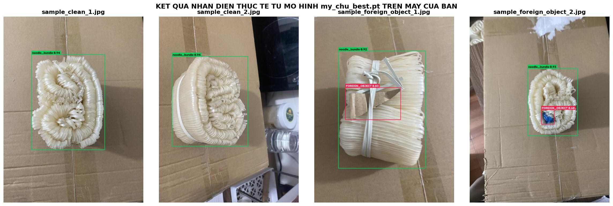
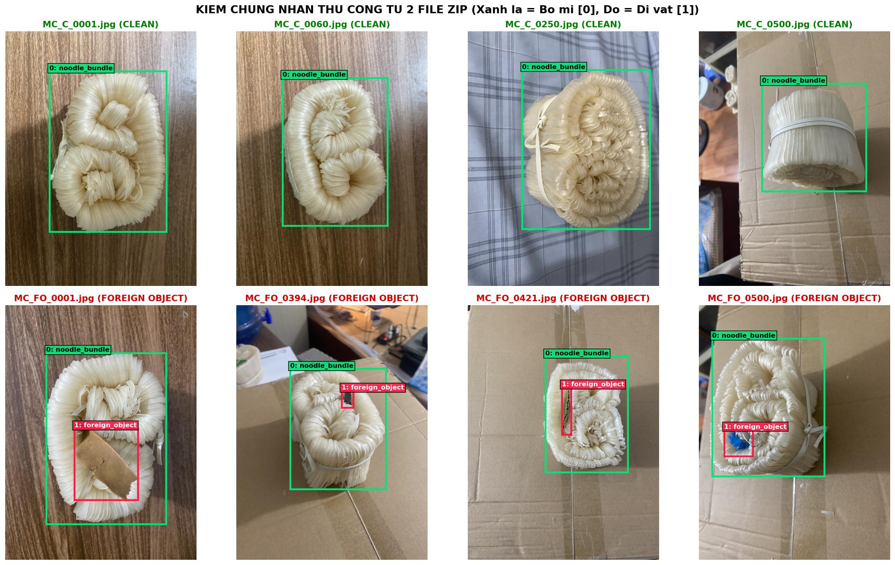

# 🍜 My Chu AI Quality Inspector — YOLOv8 Surface Foreign Object Detection

Hệ thống Trí tuệ nhân tạo (Computer Vision) hỗ trợ **định vị bó Mỳ Chũ** và **phát hiện dị vật nhìn thấy được trên bề mặt sản phẩm** bằng mô hình **YOLOv8s** cho bài toán kiểm soát chất lượng tự động (Automated Visual Quality Inspection).



---

## 1. Tổng quan bài toán & Dataset

- **Tổng quy mô dữ liệu:** `1.000` ảnh chụp thực tế sản phẩm Mỳ Chũ (độ phân giải chuẩn hóa `1440 × 1920`), bao gồm:
  - `500` ảnh sạch (`clean`): Chỉ chứa bó mì đạt chuẩn.
  - `500` ảnh có dị vật (`foreign_object`): Chứa các dị vật bề mặt như mảnh bìa carton, mảnh nhựa trong/màu, lá khô, xốp trắng, dăm gỗ, sỏi nhỏ...
- **Quy ước 2 lớp nhận diện (`2 Classes`):**
  - `0: noodle_bundle` — Định vị vùng bó Mỳ Chũ mục tiêu (`1.000` bounding boxes).
  - `1: foreign_object` — Phát hiện dị vật nằm trên bề mặt bó mì (`500` bounding boxes).
- **Chiến lược chia tập chống rò rỉ dữ liệu (Bundle-based Block Split):**
  - Phân chia theo cụm bó mì vật lý (`70% Train` = 700 ảnh | `15% Validation` = 150 ảnh | `15% Test` = 150 ảnh độc lập).



---

## 2. Kết quả thực nghiệm trên Tập Test Độc Lập (150 ảnh Hold-out)

Mô hình `YOLOv8s` (`my_chu_best.pt`) được huấn luyện trong `50 epochs` trên GPU NVIDIA Tesla T4 và đánh giá độc lập trên 150 ảnh thuộc tập `Test`:

| Lớp đối tượng (Class) | Precision | Recall | mAP@50 | mAP@50-95 | Tốc độ suy luận |
| :--- | :---: | :---: | :---: | :---: | :---: |
| **All Classes (Tổng thể)** | **95.80%** | **98.70%** | **96.34%** | **64.65%** | **6.7 ms / ảnh** |
| `0: noodle_bundle` (Bó mì) | 99.36% | 100.00% | 99.50% | 88.96% | — |
| `1: foreign_object` (Dị vật) | 92.24% | 97.33% | 93.18% | 40.34% | — |

---

## 3. Cấu trúc thư mục dự án

```text
my-chu-ai-quality-inspector/
├── app.py                                      # Giao diện Web AI Kiểm định Mỳ Chũ (Gradio)
├── my_chu_best.pt                              # Trọng số mô hình YOLOv8s tốt nhất (22.5 MB)
├── requirements.txt                            # Danh sách thư viện Python cần cài đặt
├── README.md                                   # Tài liệu giới thiệu dự án
├── .gitignore                                  # Cấu hình bỏ qua file rác Git
├── examples/                                   # 4 ảnh mẫu từ tập Test để chạy thử 1-click
│   ├── sample_clean_1.jpg
│   ├── sample_clean_2.jpg
│   ├── sample_foreign_object_1.jpg
│   └── sample_foreign_object_2.jpg
├── assets/                                     # Hình ảnh minh họa kết quả trên GitHub
│   ├── demo_prediction_result.jpg
│   └── ground_truth_samples.jpg
└── notebooks/                                  # Notebook huấn luyện & kiểm định 8 bước trên Kaggle
    └── My_Chu_YOLOv8_Training_Portfolio.ipynb
```

---

## 4. Hướng dẫn cài đặt và chạy Demo trên máy cá nhân

### Bước 1: Clone kho lưu trữ (Repository)
```bash
git clone https://github.com/<your-username>/my-chu-ai-quality-inspector.git
cd my-chu-ai-quality-inspector
```

### Bước 2: Cài đặt thư viện
```bash
pip install -r requirements.txt
```

### Bước 3: Khởi chạy giao diện Web App
```bash
python app.py
```
Sau khi chạy lệnh trên, trình duyệt sẽ tự động mở giao diện kiểm định tại địa chỉ:
👉 **`http://127.0.0.1:7860`**

---

## 5. Sử dụng nhanh bằng Python API (Tích hợp vào Backend Web)

```python
from ultralytics import YOLO

# Nạp mô hình đã huấn luyện
model = YOLO("my_chu_best.pt")

# Dự đoán trên ảnh bất kỳ
results = model.predict(source="examples/sample_foreign_object_1.jpg", conf=0.25, imgsz=640)

for box in results[0].boxes:
    cls_id = int(box.cls[0])
    conf = float(box.conf[0])
    xyxy = box.xyxy[0].tolist()
    print(f"Class: {model.names[cls_id]} | Confidence: {conf:.2%} | Box: {xyxy}")
```
